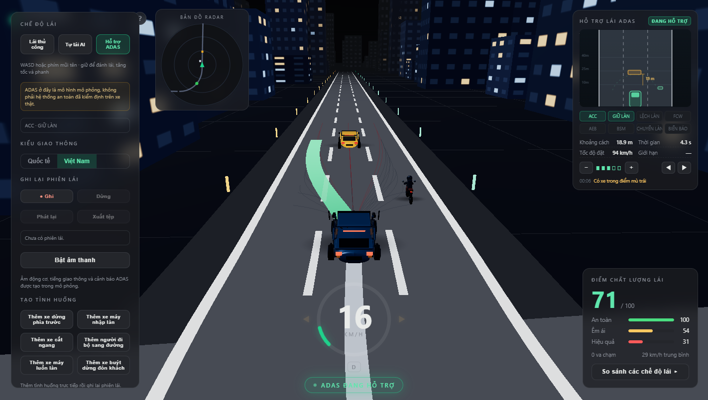
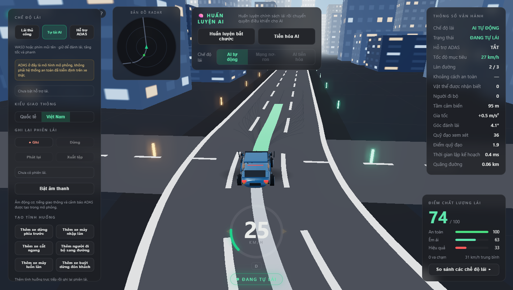
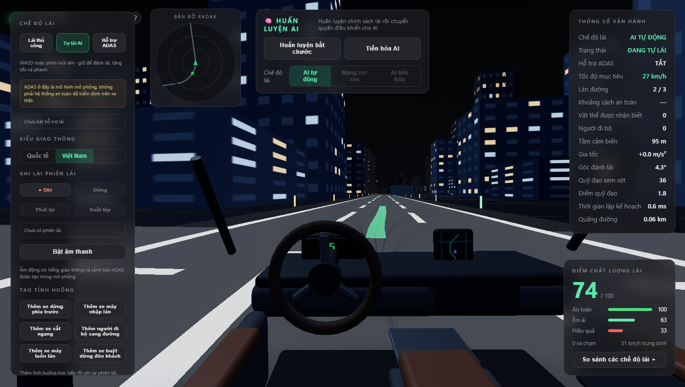

# BlueLine — Mô phỏng lái xe tự động

BlueLine là mô phỏng 3D chạy trên trình duyệt để tìm hiểu lập kế hoạch đường đi, điều khiển xe, giao thông, cảm biến và các hệ thống hỗ trợ lái. Giao diện được xây dựng theo hướng "game": có màn hình khởi động chọn chế độ, cụm đồng hồ, bảng ADAS trực quan và các phương tiện được dựng chi tiết. Mặc định ứng dụng dùng hồ sơ giao thông Việt Nam; có thể chuyển sang hồ sơ quốc tế trong bảng điều khiển.



> **Giới hạn an toàn:** động lực học xe, cảm biến, AI và ADAS trong BlueLine là các mô hình phần mềm phục vụ học tập/thử nghiệm. Chúng chưa được kiểm định trên xe thật, không phải thiết bị an toàn và không được dùng để đưa ra quyết định khi tham gia giao thông.

## Chạy ứng dụng

Yêu cầu Node.js và npm.

```bash
npm ci
npm run dev        # mở URL Vite hiển thị trong terminal
npm run build      # kiểm tra TypeScript và tạo bản dựng trong dist/
npm test           # chạy toàn bộ kiểm tra headless (23 bộ)
```

Có thể mở trực tiếp một hồ sơ/kịch bản/chế độ bằng query string:

```text
?profile=vietnam&scenario=blindspot
?mode=adas&scenario=stalled
?mode=manual&scenario=crossing&weather=rain
?scenario=lights&tod=day&cam=cockpit
?intro=0                     # bỏ qua màn hình khởi động
```

Tham số hỗ trợ: `profile` (`vietnam` / `international`), `scenario` (20 kịch bản), `mode` (`adas` / `manual`; mặc định là tự lái AI), `weather` (`rain` / `fog`), `tod` (`day`), `cam` (`chase` / `cockpit` / `top` / `orbit`), `intro=0`.

## Màn hình khởi động

Khi mở ứng dụng, menu khởi động cho chọn **chế độ lái**, **kịch bản** và **thời tiết** rồi bấm **BẮT ĐẦU LÁI**. Đây cũng là bảng trợ giúp (nút `?` góc trên trái) và liệt kê phím tắt. Ảnh: [launch-menu.png](docs/media/launch-menu.png).

## Điều khiển

- **Lái thủ công:** `WASD` hoặc phím mũi tên để lái, tăng tốc và phanh.
- **Xi nhan / chuyển làn:** `[` trái, `]` phải — bấm lần nữa để tắt; xi nhan tự tắt khi chuyển làn hoàn tất.
- **Tự lái AI:** bộ lập kế hoạch Frenet, bộ điều khiển Stanley/PID và mô hình giao thông IDM/MOBIL.
- **Hỗ trợ ADAS:** xem mục dưới. AEB mô phỏng tính khoảng cách dừng và giữ phanh khi ga vẫn được nhấn; BSM chỉ cảnh báo, không tự đánh lái tránh xe.
- Chọn camera bám theo, cabin, nhìn từ trên hoặc 360°; thay đổi mật độ giao thông, tốc độ, thời tiết và thời điểm trong ngày.
- Có thể ghi phiên lái, phát lại các khung hình đã ghi và xuất tệp JSON.
- `Space / S / M / ↓` phanh; `Esc` tạm dừng, `K` đổi camera, `F1` mở bảng điều khiển, `H` thu gọn HUD, `R` đặt lại.
- Trong cabin: giữ chuột phải kéo hoặc giữ `Num 4/6/8/2` để nhìn quanh; thả để về giữa, `Num 5` đặt lại. Góc nhìn ngang và độ cao ghế có trong Cài đặt.
- Phím phòng AI: `T` huấn luyện, `E` tiến hóa, `C/N/V` đổi AI, `B` so sánh. Chi tiết hiệu chỉnh cabin và giới hạn kiểm chứng: [báo cáo cabin](docs/CABIN_2026-10-28.md).

## Bộ hỗ trợ lái ADAS

Chế độ **Hỗ trợ ADAS** cho phép lái tay trong khi các hệ thống mô phỏng cùng hoạt động. Bảng ADAS (góc phải) hiển thị "surround view" vẽ từ chính các track Kalman mà bộ điều khiển dùng, kèm trạng thái từng hệ thống, khoảng cách, thời gian bám và nhật ký can thiệp.

| Hệ thống | Hành vi mô phỏng |
|---|---|
| **ACC** — ga tự động thích ứng | Giữ tốc độ đặt trước, bám xe phía trước với 5 mức khoảng cách (nút `−`/`+`), dừng và đi tiếp khi xe trước nhích lên |
| **LKA / LDW** — giữ làn & cảnh báo lệch làn | Bám tâm làn bằng Stanley; cảnh báo trái/phải khi bánh xe vượt mép làn |
| **FCW** — cảnh báo va chạm trước | Hai mức: cảnh báo sớm theo TTC và mức khẩn cấp khi khoảng cách dừng không còn đủ |
| **AEB** — phanh khẩn cấp tự động | Phanh tối đa khi nguy cơ va chạm, giữ phanh kể cả khi tài xế vẫn nhấn ga; nhận cả người đi bộ |
| **BSM** — cảnh báo điểm mù | Phát hiện xe ở vùng bên/lùi và báo trên gương chiếu hậu (camera bám theo) lẫn trong bảng ADAS |
| **ALC** — hỗ trợ chuyển làn | Bật xi nhan để hệ thống kiểm tra làn đích, tự đánh lái sang làn và tự tắt xi nhan; báo "không thể chuyển làn" nếu làn đích không trống |
| **TSR + ISA** — nhận biết biển & giới hạn tốc độ | Đọc biển 50 km/h gần nhất và hiển thị; bật ISA để tự giới hạn tốc độ theo biển |
| **Cảm biến đỗ xe** | Đo khoảng cách phía trước ở tốc độ thấp và cảnh báo khi tiến sát vật cản |

Mọi hệ thống đều có thể bật/tắt trong bảng điều khiển. Đây là mô hình giáo dục, không phải ADAS của xe thật.

## Phương tiện và hình ảnh

- Ba kiểu dáng ô tô (sedan, SUV/crossover, hatchback) với màu sơn theo bảng màu thực tế, biển số, gương, đèn và cụm đèn phanh.
- Bánh xe quay theo tốc độ và bánh trước đánh lái; thân xe nghiêng khi chuyển làn và chúi đầu khi phanh; xe máy nghiêng cả khung khi vào cua.
- Đèn phanh sáng khi giảm tốc, xi nhan nháy khi chuyển làn (xe hỏng bật đèn cảnh báo), đèn pha tự bật vào ban đêm.
- Bóng đổ tiếp xúc dưới từng xe, ánh sáng môi trường IBL và cửa sổ toà nhà phát sáng vào ban đêm.
- Camera cabin có vô lăng quay theo góc lái, cụm đồng hồ hiển thị tốc độ và biển giới hạn.




## Hồ sơ và tình huống

Mô phỏng có 16 kịch bản trên cùng một đường vòng đô thị ba làn. Nhóm tình huống gồm đường vành đai, xe tải, xe chết máy, xe nhập làn, giao thông đông, người đi bộ qua đường/khuất tầm nhìn/băng ngang, điểm mù xe máy, đèn giao thông và giờ cao điểm; bổ sung thêm:

- Xe máy luồn làn.
- Xe buýt dừng đón khách.
- Hàng xe ùn tắc.
- Xe tải hỏng giữa đường.
- Phố Việt Nam giờ cao điểm với xe máy và người đi bộ.

Bảng **Tạo tình huống** cũng cho phép đưa xe dừng, xe máy nhập làn/luồn làn, xe cắt ngang, người đi bộ và xe buýt dừng vào phiên đang chạy.

Các tình huống Việt Nam hiện được dựng theo quy tắc kịch bản trên một đường mẫu chung. Đây chưa phải bản đồ đường phố Việt Nam, mô hình dòng xe cấp quốc gia hay mô phỏng đầy đủ luật ưu tiên tại giao lộ.

## Bản đồ module hiện có

| Phần | Module | Trạng thái đã kiểm tra |
|---|---|---|
| Đường và xe | `src/world/`, `src/vehicle/` | Đường vòng đô thị cố định; động lực học xe đạp động học đơn giản hóa |
| Lập kế hoạch | `src/planner/`, `src/behavior/`, `src/control/` | Lập quỹ đạo Frenet; quyết định bám xe/dừng/vượt/nhường; Stanley và PID nối vào mô phỏng |
| Giao thông | `src/traffic/`, `src/pedestrian/` | IDM/MOBIL, hồ sơ quốc tế/Việt Nam, xe máy/xe buýt/xe tải, người đi bộ và kịch bản sự kiện |
| Nhận biết | `src/perception/` | Cảm biến có nhiễu và giới hạn tầm nhìn, bộ theo dõi Kalman, lưới chiếm chỗ để hiển thị |
| Đèn/biển | `src/world/TrafficLight.ts`, `src/world/RoadSign.ts` | Đèn định thời và giới hạn tốc độ cho luồng lập kế hoạch cổ điển; chưa có luật ưu tiên giao lộ đầy đủ |
| AI học | `src/learn/` | Mạng nơ-ron, học bắt chước/DAgger, tiến hóa và so sánh chính sách |
| ADAS | `src/sim/ADAS.ts`, `src/ui/ADASPanel.ts` | ACC stop & go, giữ làn, LDW, FCW, AEB, BSM, ALC, TSR/ISA và cảm biến đỗ xe — tất cả là mô hình mô phỏng |
| Phiên lái | `src/sim/SessionRecorder.ts`, `src/sim/Metrics.ts` | Thống kê, ghi/phát lại ảnh chụp trạng thái, xuất JSON; chưa phát lại bằng mô phỏng xác định lại từ đầu |
| Hiển thị/âm thanh | `src/render/`, `src/audio/` | Xe dựng thủ tục có animation bánh/lái/nghiêng thân, thành phố có cửa sổ phát sáng, mưa/sương, âm tổng hợp (động cơ, lốp trượt, xi nhan, cảnh báo, va chạm) |
| Giao diện | `src/ui/` | Menu khởi động, HUD cụm đồng hồ, bảng ADAS, bảng điều khiển, bảng học AI, minimap, scorecard |

Xem [bản đồ module và giới hạn chi tiết](docs/BAN_DO_MODULE.md). Bản README tiếng Anh cũ được giữ tại [README.en.md](README.en.md).

## Kiểm tra hiện có

`npm test` chạy toàn bộ 15 bộ kiểm tra headless (tự bundle bằng esbuild, không cần cài thêm `tsx`):

```bash
npm run build
npm test
```

Các bộ chính:

- `smoke`, `all-scenarios-smoke`, `vietnam-scenario-smoke`: 16 kịch bản, chạy dài, không va chạm/không rời đường.
- `adas-test`, `adas-brake-test`: lái tay, ACC, giữ làn, FCW, AEB, BSM và tình huống giữ ga khi AEB phanh (kể cả trời mưa/sương mù).
- `adas-features-test`: chuyển làn hỗ trợ (làn trống và làn bị chặn), tự tắt xi nhan, TSR/ISA, LDW và cảm biến đỗ xe.
- `lights-test`, `weather-test`, `road-sign-test`, `record-replay-test`, `scenario-lab-test`, `traffic-profile-test`: đèn, thời tiết, biển báo, ghi/phát lại, sự kiện trực tiếp và hồ sơ giao thông.
- `learn-test`, `evo-test`: học bắt chước và tiến hóa.

Kết quả kiểm tra chỉ xác nhận hành vi trong mô hình và cấu hình kiểm thử, không phải chứng nhận an toàn ngoài đời.

## Những phần còn thiếu

- Bản đồ mạng lưới đường phố/chạy xuyên quốc gia, giao thông trái/phải theo từng nơi và luật ưu tiên/rẽ tại giao lộ.
- Hành vi xe máy, người đi bộ và phương tiện phong phú hơn dựa trên dữ liệu đường thực; mô hình mật độ hiện tại vẫn là kịch bản thủ công.
- Mô hình ảnh camera, lidar/radar, hợp nhất cảm biến và hiệu chuẩn vật lý.
- Tài sản 3D/âm thanh chất lượng cao thu thật, trình biên tập tình huống tự do và nhập phiên ghi.
- Phát lại xác định lại từ đầu, tối ưu kích thước gói (vẫn còn cảnh báo >500 kB) và kiểm tra khả năng dùng trên thiết bị di động.

BlueLine chạy trên TypeScript, Three.js và Vite, không có backend. Mã mô phỏng được thiết kế để chạy headless cho các kiểm tra tự động.
