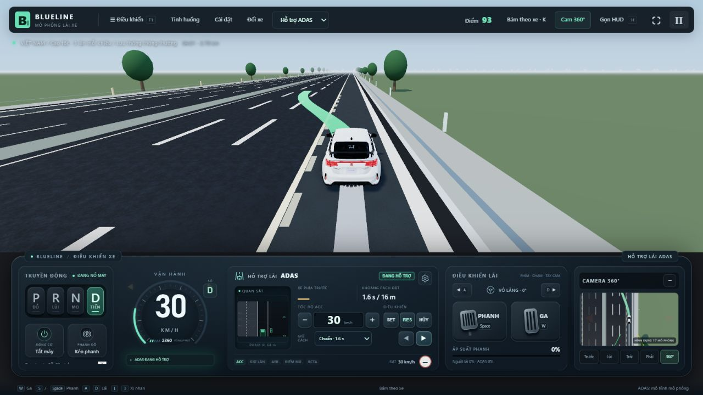
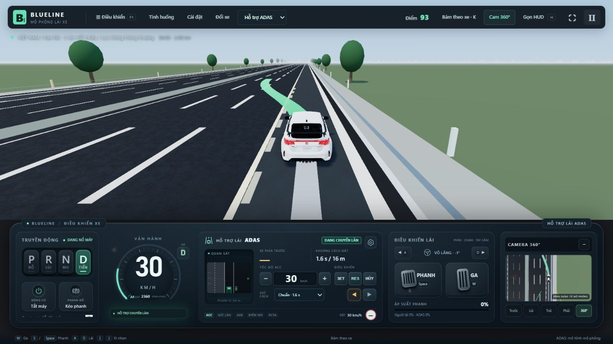

# ACC, AEB và chuyển vào/ra làn khẩn cấp

Ngày đối chiếu và triển khai: 29/10/2026.

## Nghiên cứu từ nguồn chính thức

- [Kia Sportage NQ5, tài liệu Mỹ 2026 — SCC](https://ownersmanual.kia.com/full_webhelp/NQ5KH/2026/en_US/topics/chapter7_10_2.html): SCC điều chỉnh theo xe trước và tốc độ đặt; không hoạt động khi FCA đang điều khiển phanh. Có hủy, phục hồi, điều kiện dừng/chạy và khoảng cách chọn được. Không lấy thông số một phiên bản làm tiêu chuẩn chung.
- [Kia Sportage NQ5, tài liệu Mỹ 2024 — FCA camera trước](https://ownersmanual.kia.com/full_webhelp/NQ5KH/2024/en_US/topics/chapter7_1_2.html): phân biệt cảnh báo, phanh khẩn cấp và kết thúc giữ phanh. Biến thể này nêu giữ khoảng 2 s sau dừng và có thể hủy bởi ga mạnh/lái gấp; có hỗ trợ khi người lái phanh thiếu. Không áp dải tốc độ riêng của biến thể camera này cho mọi FCA.
- [Volvo V60 2016, trang hỗ trợ Canada cập nhật 2023](https://www.volvocars.com/en-ca/support/car/v60/15w46/article/4b5dbcb3aa3a57c8c0a801e800b44ec1/): ACC nhằm điều tiết tốc độ êm và khoảng thời gian bám xe; không phải hệ thống tránh va chạm. Giới hạn phanh và tốc độ thấp nêu trong trang là của hệ thống đời đó, không dùng làm thông số BlueLine hoặc mọi Volvo mới.
- [NHTSA — Driver Assistance Technologies](https://www.nhtsa.gov/vehicle-safety/driver-assistance-technologies): phân biệt ACC giữ khoảng cách, FCW cảnh báo, AEB tự phanh khi nguy cấp và hỗ trợ bổ sung lực khi người lái phanh thiếu.

## Cách phối hợp trong BlueLine

| Tình huống | Điều khiển thực hiện |
|---|---|
| Đường trống / bám xe bình thường | ACC dùng tốc độ đặt, thời gian bám và khoảng cách thân xe; giới hạn gia tốc, giảm tốc thường và tốc độ thay đổi gia tốc. |
| Xe trước giảm tốc / tạt vào | ACC giảm mục tiêu; FCW/AEB đánh giá riêng vận tốc tương đối, TTC, khoảng dừng, độ bám và đường quét thân xe. Không chỉ dựa vào một ngưỡng TTC. |
| Người lái đạp ga rồi nhả | Ga cho phép tạm vượt điều khiển ACC; khi nhả, ACC nhận lại từ gia tốc thực đang áp dụng. Đây là phần sửa mới, tránh bước nhảy về 0. |
| Người lái đạp phanh | Hủy ACC và giữ quyền phanh chân; nhả phanh không tự bật ACC. AEB vẫn có thể bù lực nếu phanh chưa đủ. |
| Nguy hiểm vượt khả năng phanh thường | AEB có ưu tiên, hủy ACC, áp phanh cần thiết. Bộ làm mượt ACC không trì hoãn phanh khẩn cấp. |
| Sau AEB | Giữ dừng theo cấu hình hiện có; ACC không tự bật lại. Cần điều kiện an toàn và thao tác RES. |

Đã giữ các bộ điều khiển phanh/động lực đang hoạt động, không viết lại chúng. Sửa mới nằm ở chuyển giao ga → ACC và quyền điều khiển ngang từ/đến làn khẩn cấp. Trạng thái chuyển giao được ghi/phát lại cùng bộ điều khiển.

Giới hạn thay đổi gia tốc thường hiện dùng khoảng +1,8 / −2,5 m/s³ là hiệu chỉnh **BlueLine**, không phải số được hãng công bố. AEB có thể phanh gấp, gây giật; không làm yếu phanh nguy cấp chỉ để tạo cảm giác êm. Ma sát và khoảng dừng vẫn quyết định khả năng tránh va chạm.

BlueLine tiếp tục giữ phanh AEB trước vật cản khi người dùng giữ ga theo yêu cầu chống bò/đâm của dự án. Điều này khác cơ chế hủy bằng ga mạnh hoặc nhả giữ sau khoảng 2 s của biến thể Kia tham khảo. Chưa mô phỏng ECU OEM, thủy lực phanh, ABS từng bánh hay toàn bộ lỗi cảm biến thực.

## Vào và ra làn khẩn cấp

Theo lựa chọn người dùng, thêm công tắc **ALC-LỀ · Thử nghiệm vào/ra làn khẩn cấp**, mặc định bật trong mô phỏng.

- Từ làn chạy ngoài cùng, xi-nhan phải yêu cầu vào tâm làn khẩn cấp.
- Từ làn khẩn cấp, xi-nhan trái yêu cầu nhập đúng làn chạy ngoài cùng, không bỏ qua một làn vì phép tính lane index bị chặn ở mép đường.
- LFA bám tâm làn khẩn cấp sau khi vào, tránh kéo về làn cũ hoặc bỏ giữ lái khi gặp đường cong.
- Vẫn kiểm tra xe trước/sau, xe đang lao lên, khoảng trống, cảm biến, trạng thái xe, quyền tiếp quản và giới hạn bề rộng phần đường. Không có làn khẩn cấp thì không tạo mục tiêu giả; không chuyển tiếp ra ngoài mép làn khẩn cấp.
- Cần chế độ ADAS, D, động cơ bật, EPB nhả và ACC + LFA sẵn sàng. Sau EDSS đã đỗ ở P, phải tiếp quản tài xế, chọn D, nhả EPB và phục hồi ACC trước khi nhập lại. Không coi việc bật xi-nhan là lệnh tự nhả phanh đỗ.

Đây là chức năng thử nghiệm theo yêu cầu trong BlueLine, không phải xác nhận ALC của xe thật cho phép dùng làn khẩn cấp như làn lưu thông.

## Kiểm chứng

- [9/9 nhóm kiểm thử đạt](ACC_AEB_SHOULDER_TESTS_2026-10-29.log), 23,8 s: chuyển giao ga một khung hình và giữ ga lâu; AEB ưu tiên ngay trên khung chuyển giao; replay; nhập từ làn khẩn cấp với dữ liệu thế giới/cảm biến nhiễu, khô/ướt; vào rồi ra làn khẩn cấp trong cả khô/ướt; xe sau nhanh làm từ chối; các bài bám xe/phanh hiện có.
- Các bài đo tiếp xúc, vị trí làn đích, trạng thái xi-nhan, gia tốc và tốc độ thực, không thay bằng chỉ kiểm tra đèn cảnh báo.
- [Build đạt](ACC_AEB_SHOULDER_BUILD_2026-10-29.log); vẫn có cảnh báo kích thước gói Three.js.
- Sau thay đổi cuối về cả hai hướng, [8/8 nhóm hồi quy đạt](ACC_AEB_SHOULDER_FINAL_2026-10-29.log), 95,0 s: EDSS, bấm xi-nhan lặp, miền cao tốc, giữ làn tốc độ cao, phục hồi qua cua, quyền phanh/điều khiển và bàn phím. Tổng hai đợt cuối: **17 nhóm đã đạt**.
- Đã thử trên trình duyệt bằng nút thật: từ làn chạy ngoài cùng vào làn khẩn cấp ở 30 km/h, giữ ổn định và tự tắt xi-nhan; sau đó dùng xi-nhan trái và xác nhận xe đã trở lại làn chạy ngoài cùng, xi-nhan tự tắt, không có lỗi console. Không dùng API trạng thái ẩn để tạo kết quả.

