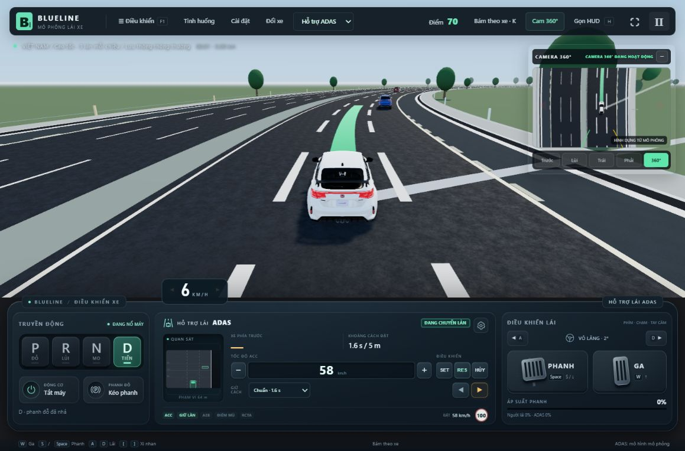
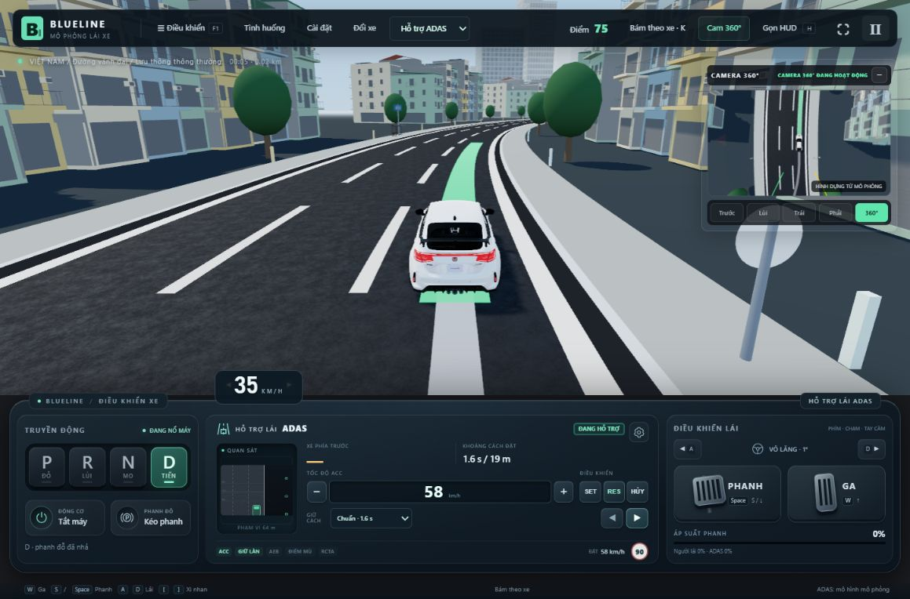

# ALC hỗ trợ mọi dải tốc độ đang chạy

Cập nhật ngày 29/10/2026, theo yêu cầu bỏ giới hạn tốc độ khởi đầu. Tài liệu này thay thế giới hạn 80/15 km/h trong báo cáo sửa ALC trước đó.

## Hành vi hiện tại

- Không còn ngưỡng khởi đầu 80 km/h hoặc 15 km/h. ALC có thể bắt đầu khi xe đang bò chậm, chạy trong phố hoặc chạy tốc độ cao, nếu có làn cùng chiều hợp lệ và đủ điều kiện an toàn.
- Mặc định cho phép trên đường nhiều làn cùng chiều. Công tắc **“Chỉ cho phép ALC trên cao tốc”** là giới hạn phạm vi đường tùy chọn; bật nó cũng không thêm ngưỡng 80 km/h.
- Khi đứng yên, xi-nhan giữ yêu cầu ở trạng thái **chờ xe di chuyển**. ALC không tự thêm ga hoặc thay tốc độ ACC để ép xe xuất phát. Nếu đã vào quá trình chuyển làn rồi dừng, tiến độ quỹ đạo dừng theo xe và có thể tiếp tục khi xe chạy lại; bàn đạp phanh/tiếp quản vẫn có quyền hủy.
- Vẫn cần ACC + LFA, camera/vạch làn, radar sau, điều kiện xe và tay người lái. Vẫn kiểm tra xe trước/sau, xe điểm mù, người đi bộ và giao lộ. Không dùng vỉa hè hoặc phần đường ngược chiều làm làn chạy. Cập nhật theo yêu cầu người dùng: [ALC-LỀ cho phép thử vào/ra làn khẩn cấp](ACC_AEB_PHOI_HOP_VA_LAN_KHAN_CAP_2026-10-29.md), với kiểm tra khoảng trống và giữ làn riêng.
- Người lái phanh hoặc đánh lái vẫn hủy; nhả phanh không tự bật lại ACC. Cần RES và bật lại xi-nhan khi yêu cầu trước đã bị hủy vì an toàn/tiếp quản.
- Cập nhật tiếp: khi ALC đã chuyển làn, bấm lặp xi-nhan không đảo hướng hay hủy về làn cũ; hoàn tất lượt hiện tại rồi mới nhận yêu cầu mới. [Hành vi và kiểm thử bấm lặp](SUA_XI_NHAN_GIUA_LAN_2026-10-29.md).

## Các thay đổi thật trong bộ điều khiển

Chỉ xóa điều kiện tốc độ sẽ làm quỹ đạo cũ kết thúc sau 3,6 s dù xe bò được chưa tới một mét. Đã thay bằng tiến độ theo vận tốc/quãng đường: tối thiểu khoảng 18 m tiến dọc cho một bước chuyển làn ở tốc độ thấp, với tốc độ tiến triển tối đa tương ứng 3,6 s. Quỹ đạo bậc năm có hướng tiếp tuyến và bù độ cong; xe vẫn đi qua mô hình động lực, giới hạn vô-lăng và độ bám hiện có.

Quá trình không còn bị hủy sau đúng 9 s khi xe đang bò chậm hợp lệ. Ngân sách phát hiện không bám được quỹ đạo cũng đi theo tiến độ chuyển động; xe đứng yên không âm thầm chạy hết quỹ đạo. Hoàn tất cần xe gần tâm làn đích và hướng xe ổn định. Đã ngăn cơ chế tự tắt xi-nhan thủ công hủy ALC quá sớm ở lần đầu xe đi qua tâm làn.

Khoảng trống dự báo thích ứng theo vận tốc: khoảng đệm thân xe tối thiểu 3 m, tăng theo tốc độ; nhìn trước 5–12 s và kiểm tra lại liên tục. Xe đang lao lên từ phía sau vẫn làm ALC từ chối, kể cả khi xe người lái rất chậm. Những con số này là hiệu chỉnh BlueLine, không phải ngưỡng được chứng nhận của hãng xe.

Replay lưu tiến độ mới. Bản ghi cũ không có trường này dùng bộ chuyển từ thời gian cũ để tiếp tục trạng thái; không thay đổi vị trí đã ghi.

## Kiểm thử

- [Ma trận tốc độ](ALC_ALL_SPEEDS_MATRIX_2026-10-29.log): **92 lượt động lực** qua các tốc độ 0,5; 1; 3; 5; 10; 15; 30; 50; 79; 80; 100; 130; 160; 180; 198 km/h, hai hướng trái/phải, độ bám khô/ướt. Nhóm đường cong dùng các tốc độ đến 50 km/h; không giả định mọi cua đều chạy được ở tốc độ tối đa. Kiểm tra xe đến làn đích, hướng ổn định, không ra khỏi phần đường, không nhảy vị trí/vô-lăng và gia tốc ngang dưới 4,5 m/s². Giàn thử này giữ tốc độ để cô lập điều khiển ngang.
- Sáu bài tích hợp `Simulation` từ 0/1/5/15/30/60 km/h dùng ACC tăng/giảm tốc thật, không giữ vận tốc bằng giàn thử. Đều hoàn tất, tự tắt xi-nhan, không va chạm/ra khỏi đường; từ đứng yên ALC bắt đầu khoảng 1,1 km/h.
- Có bài đứng yên 10 s rồi đi tiếp, dừng giữa quá trình rồi tiếp tục, khôi phục replay, cặp xe chạy chậm có khoảng trống hợp lệ, xe sau nhanh và từ chối yêu cầu khi xe đang ở làn khẩn cấp.
- [Hồi quy](ALC_ALL_SPEEDS_REGRESSION_2026-10-29.log): **20/20 nhóm đạt**, 389,7 s, gồm ADAS/phanh, giữ làn tốc độ cao, bàn phím, replay, EDSS, ma trận 120 lượt tình huống và mạng đường.
- Sau chỉnh cuối, [8/8 nhóm liên quan chạy lại đạt](ALC_ALL_SPEEDS_FINAL_2026-10-29.log), 8,2 s, bao gồm ma trận 92 lượt. [Build đạt](ALC_ALL_SPEEDS_BUILD_2026-10-29.log); vẫn có cảnh báo kích thước gói Three.js.
- Trình duyệt: quan sát ALC nhận lệnh khi xe khoảng 5–8 km/h trên cao tốc; trên đường vành đai quan sát trạng thái chuyển làn ở khoảng 26 km/h, sau đó xe đến làn ngoài cùng và xi-nhan tự tắt ở khoảng 37 km/h. Mật độ giao thông được điều chỉnh bằng thanh UI để thử hành lang trống. Không dùng trạng thái ẩn để tạo kết quả.

## Phạm vi

Đây là cấu hình ALC mọi dải tốc độ của **BlueLine**, không khẳng định mọi xe thương mại có cùng khả năng hay mọi tốc độ đều an toàn với mọi khúc cua. Vẫn giữ giới hạn động lực, độ bám, nhận biết và khoảng trống. Đợt kiểm thử này không xác nhận mọi tình huống thực tế hoặc hiệu năng trên mọi thiết bị.
