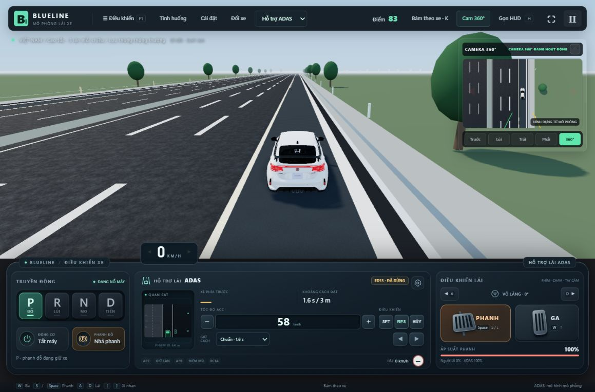

# Làn khẩn cấp cao tốc và dừng khi tài xế không phản hồi

Ngày thực hiện: 29/10/2026. Đây là mô hình hành vi tổng hợp của BlueLine, không phải ECU được hãng xe hiệu chuẩn hay hệ thống chẩn đoán y tế.

## Đã triển khai

- Cao tốc có **làn dừng khẩn cấp rộng 3,5 m ở mép ngoài mỗi chiều**, mặt đường riêng, vạch liền và dải nhám. Lan can/cọc đường và hình học va chạm được đưa ra ngoài lề mới. Xe giao thông thông thường vẫn chọn các làn chạy xe.
- Sửa bố trí **riêng bản đồ cao tốc** sang phần đường bên phải của dải phân cách. Các bản đồ quốc lộ/hai chiều lịch sử giữ bố trí cũ trong đợt này. Có bộ chuyển tọa độ cho bản ghi cao tốc cũ.
- Thêm công tắc **EDSS · Tấp lề khi tài xế không phản hồi**, phối hợp DMS/DAW. Không phản hồi dẫn tới cảnh báo tăng cấp, hủy ACC, bật hai đèn cảnh báo và giảm tốc. Bài thử nhanh có thể chủ động tiêm trạng thái mất khả năng lái.
- Xe kiểm tra hành lang dự báo, xe trước/sau và khoảng trống; chuyển **từng làn liền kề** sang phải, ổn định rồi mới kiểm tra bước tiếp theo. Khi đủ chỗ, đi vào làn khẩn cấp, phanh dừng, về **P và bật EPB**. Mọi chuyển động đi qua động lực xe và kiểm tra thân xe đang có; không đặt lại vị trí để tạo kết quả đỗ.
- Nếu lề bị chặn, xe phía sau đang lao lên, cảm biến/điều kiện xe không cho phép hoặc không bám được quỹ đạo: chờ khoảng trống có giới hạn rồi phanh có kiểm soát. Nguy hiểm mới giữa chừng hủy bước chuyển làn; chỉ quay về khi hành lang về cũng trống. Xe đang dừng không tự khởi hành để tìm lề.
- Ga, phanh hoặc đánh lái mới cho phép người lái tiếp quản. Đã sửa lỗi phát hiện thao tác lái được làm mượt ở tốc độ cao và bàn đạp tăng lực từ từ; giữ nguyên một bàn đạp từ trước không liên tục xác nhận tài xế còn phản hồi. Sau khi dừng ở P, người lái phải chủ động chọn số/nhả EPB để đi tiếp.
- AEB/BCA/PMC và phanh chân mạnh hơn vẫn giữ ưu tiên. Quỹ đạo hiển thị là quỹ đạo EDSS thực; ẩn dải lịch sử trắng khi EDSS đang hoạt động. Đèn cảnh báo hai bên trong cảnh 3D, đồng hồ và tiếng rơ-le dùng thời gian mô phỏng. Ghi/phát lại lưu trạng thái quá trình tấp lề.

## Cách thử trong giao diện

1. Chọn bản đồ **Cao tốc · 3 làn mỗi chiều**, chế độ **Hỗ trợ ADAS**.
2. Mở bánh răng trong cụm ADAS → **Thử nghiệm** → **Bài thử mới · tài xế mất khả năng lái**.
3. Bài thử bắt đầu phiên mới ở 100 km/h, xóa giao thông hiện tại, đặt tài xế không phản hồi và chạy quy trình tấp lề. Nút ghi rõ việc tạo lại phiên trước khi nhấn.
4. Để thử tăng cấp tự nhiên cùng giao thông hiện tại, dùng hai đầu vào **Tài xế mất tập trung** / **Tài xế bỏ tay khỏi vô-lăng**, không dùng nút tạo bài thử. Có thể tiêm lỗi cảm biến để kiểm tra phương án dừng trong làn.
5. Nhấn A/D, W hoặc Space/S để kiểm tra tiếp quản. Chỉ đánh dấu mất tập trung không có nghĩa hệ thống đã phát hiện một người đột quỵ.

## Hiệu chỉnh và giả định mô phỏng

- Thời gian BlueLine: cảnh báo mất tập trung sau 2 s/bỏ tay sau 5 s; yêu cầu tiếp quản sau 10/15 s; yêu cầu dừng sau 15/20 s nếu vẫn không phản hồi. Đây không phải các mốc được xác nhận của hãng xe.
- Giảm tốc ban đầu khoảng 2 m/s², tốc độ chuẩn bị chuyển làn khoảng 50 km/h và giảm theo độ bám. Quỹ đạo chuyển làn bậc năm dài 5 s, đánh giá lại khoảng 0,15 s; chờ tối đa 6 s trước khi chọn dừng trong làn. Dự báo vào lề bao gồm cả đoạn phanh dừng. Các ngưỡng là hiệu chỉnh BlueLine.
- Dùng vật thể từ pipeline cảm biến/theo dõi hoặc chế độ dữ liệu thật của thế giới, cùng mô hình dự báo vận tốc. Camera/radar lỗi không cho phép chuyển làn tự động. **Định vị và bản đồ trong mô phỏng là lý tưởng**: nếu mất nhận biết vạch/camera, phương án phanh vẫn dùng đường đã biết để theo làn hiện tại qua cua. Chưa có mô hình sai số định vị hoặc bộ điều khiển dự phòng xe thật.
- Chưa nhận diện mặt/mắt/sức khỏe từ video, chưa chẩn đoán đột quỵ, chưa gọi cứu hộ/eCall hay truyền vị trí ra ngoài. Chưa có tất cả cấu hình đường/xe cắt ngang/tình huống bất khả tránh. Khoảng dừng, độ bám và giới hạn cảm biến vẫn có thể làm va chạm không tránh được.
- Bản ghi cao tốc cũ có kiểm thử chuyển tọa độ cơ bản; chưa kiểm chứng mọi tệp lịch sử người dùng có thể lưu.

## Nguồn tham chiếu và khác biệt

- [Toyota RAV4 Nhật, công bố 17/12/2025](https://global.toyota/en/newsroom/toyota/43740895.html): hệ thống ứng phó tài xế bất thường cảnh báo, giảm tốc và dừng trong làn hoặc lề; tùy trang bị/dịch vụ. [Công bố giới thiệu 21/05/2025](https://global.toyota/en/newsroom/toyota/42758168.html) nêu điều kiện tấp lề khi chạy làn đầu tiên trên cao tốc/đường dành riêng ô tô. BlueLine mở rộng kiểm tra rồi chuyển từng làn từ các làn bên trong; không gọi đó là hành vi Toyota đã công bố cho mọi làn.
- [BMW USA, Emergency Stop Assistant](https://faq.bmwusa.com/s/article/Driver-assistance-systems-Intelligent-driving-Emergency-Stop-Assistant-Operating-principle-ENIS5): tùy trang bị/thị trường có thể chuyển làn về mép đường/cao tốc khi làm được; đông xe có thể dừng ngay trong làn. Biến thể FAQ yêu cầu người trong xe kích hoạt, khác kích hoạt không phản hồi tự động của BlueLine.
- Cơ chế cảnh báo/tiếp quản/dừng trong làn còn đối chiếu Volvo EX90 trong [tài liệu nghiên cứu ADAS](ADAS_THAM_CHIEU_2026-10-29.md). EDSS hiện tại tổng hợp các hành vi, không mô phỏng đúng một ECU hay hứa tương đương chứng nhận xe thật.

## Kiểm chứng

- `scripts/emergency-shoulder-test.ts`: hình học đường/lan can; 12 lượt ba làn × khô/mưa × dữ liệu thế giới/cảm biến; cua khô/mưa; sương; lề bị chặn; xe sau nhanh; xe đứng yên xuất hiện muộn; mất camera/radar/vạch/toàn bộ cảm biến; tiếp quản phanh/ga/lái; bàn đạp tăng lực chậm; tắt EDSS giữa chừng; DMS tăng cấp tự nhiên; replay giữa quỹ đạo và fixture bản ghi cũ. Đo va chạm, biên đường, bề rộng thân xe, tốc độ dừng và gia tốc ngang.
- `scripts/drive-input-test.ts`: đưa sự kiện A/D/W/Space qua chính `DriveControls`, xác nhận ngay thao tác lái đầu tiên ở tốc độ cao hủy EDSS; không chỉ tiêm giá trị vô-lăng lớn trực tiếp.
- Đã chạy trực tiếp bằng trình duyệt: kích hoạt bài thử, nhấn A để tiếp quản rồi chạy lại đến khi xe nằm hoàn toàn trong lề phải, 0 km/h, P và EPB. Không có lỗi console ở lần kiểm tra. Ảnh bên dưới là trạng thái thực của trang đang chạy.
- Toàn bộ **53/53 nhóm kiểm thử đạt**, 947,3 s: [log hồi quy](EMERGENCY_SHOULDER_FULL_2026-10-29.log). Sau các sửa cuối về tiếp quản, phanh theo làn khi mất camera và sương mù, **5/5 nhóm liên quan chạy lại đạt**, 86,2 s: [log kiểm tra cuối](EMERGENCY_SHOULDER_TARGETED_FINAL_2026-10-29.log). **1/1 nhóm âm thanh chạy lại đạt**, gồm tiếng rơ-le đèn khẩn cấp: [log âm thanh](EMERGENCY_SHOULDER_AUDIO_2026-10-29.log).
- **Build cuối đạt**: [log build](EMERGENCY_SHOULDER_BUILD_2026-10-29.log). Vẫn có cảnh báo kích thước gói Three.js 551,89 kB; đây chưa phải xác nhận hiệu năng trên mọi thiết bị.

