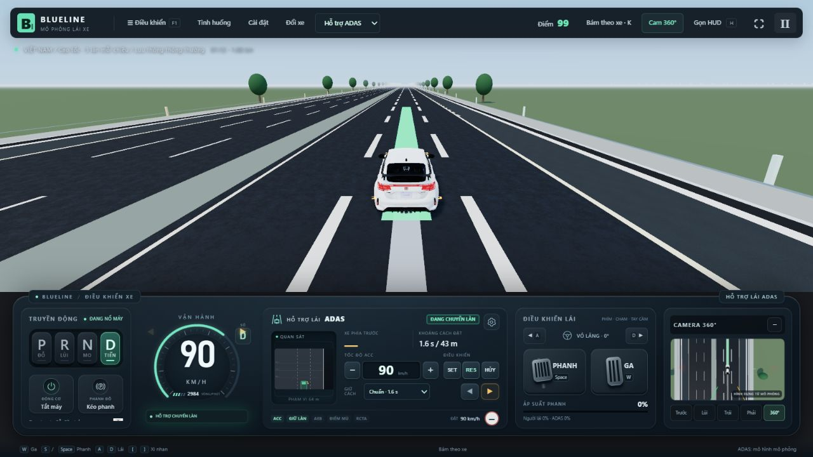

# Sửa ALC từ chối yêu cầu xi-nhan

Ngày: 29/10/2026.

**Cập nhật tiếp theo:** giới hạn 80/15 km/h mô tả bên dưới đã được bỏ theo yêu cầu người dùng. Xem [ALC mọi dải tốc độ](ALC_MOI_DAI_TOC_DO_2026-10-29.md) để biết hành vi và kiểm thử mới nhất. Phần dưới giữ làm lịch sử lỗi trước khi nâng cấp.

## Nguyên nhân tìm được

1. Cấu hình mặc định BlueLine chỉ bắt đầu ALC trên cao tốc từ 80 km/h, cần ACC + LFA và cảm biến/điều kiện xe phù hợp. Làn bên cạnh trống chưa đủ điều kiện. Trước đây bảng chính chỉ ghi “ALC · CHƯA ĐỦ ĐIỀU KIỆN”, còn nguyên nhân bị giấu trong tooltip và bảng cài đặt. Điều này đặc biệt khó hiểu khi dùng điện thoại.
2. Bộ điều khiển dùng chung chốt hủy cho cả **yêu cầu ban đầu chưa đủ điều kiện** và **thao tác đang chạy bị hủy**. Bật xi-nhan dưới ngưỡng tốc độ, thiếu xác nhận tay hoặc radar sau không sẵn sàng có thể làm yêu cầu bị khóa ngay cả khi điều kiện sau đó đã đủ.
3. Ngưỡng tốc độ khởi đầu còn được áp lại giữa quá trình chuyển làn. ACC giảm tốc nhẹ dưới ngưỡng có thể hủy bước chuyển làn đang thực hiện.

## Đã sửa

- Yêu cầu ban đầu tiếp tục được đánh giá khi xi-nhan còn bật. Khi đủ điều kiện, chạy lại thời gian kiểm tra 0,45 s trước khi bắt đầu; không bỏ kiểm tra xe trước/sau hoặc cảm biến.
- Nếu đã bắt đầu nhưng mất điều kiện an toàn, người lái phanh/đánh lái hoặc quá thời gian, vẫn hủy và yêu cầu **tắt rồi bật lại xi-nhan**. Bảng hiển thị hướng dẫn này thay vì mắc ở lý do cũ.
- Ngưỡng 80 km/h là điều kiện **bắt đầu** trong cấu hình cao tốc. Một lần giảm tốc dưới ngưỡng không tự hủy thao tác đã bắt đầu; các kiểm tra va chạm, khoảng trống, cảm biến, tay người lái và phanh vẫn giữ nguyên.
- Hiển thị nguyên nhân cụ thể ngay ở dòng trạng thái dưới cụm ADAS, kể cả khi bảng cài đặt đóng. Nút trái/phải có nhãn trợ năng rõ ràng.
- Chế độ thí nghiệm ngoài cao tốc có ngưỡng khởi đầu rõ ràng 15 km/h, thay cho việc trả về im lặng ở tốc độ rất thấp. Bỏ chọn “ALC chỉ trên cao tốc, từ 80 km/h” trong cài đặt để dùng chế độ này; vẫn khóa gần giao lộ/người đi bộ và khi không đủ khoảng trống. Đây không phải cấu hình OEM.

## Kiểm chứng

- Trước khi sửa, bài tái hiện báo `initial speed rejection stayed latched after conditions recovered`: [log lỗi gốc](ALC_REPRO_2026-10-29.log).
- Sau sửa: **8/8 nhóm kiểm thử đạt, 80,5 s**: [log kiểm thử](ALC_FIX_TESTS_2026-10-29.log). Gồm phục hồi điều kiện tốc độ/tay/radar sau, tốc độ giảm sau khi bắt đầu, tiếp quản rồi bật lại xi-nhan, làn trống với cảm biến nhiễu, xe sau nhanh, rào công trường, hoàn thành và tự tắt xi-nhan, bàn phím, replay, giữ làn tốc độ cao và EDSS/làn khẩn cấp.
- Build đạt: [log build](ALC_FIX_BUILD_2026-10-29.log). Còn cảnh báo kích thước gói Three.js, không có lỗi biên dịch.
- Đã thao tác trực tiếp trên trình duyệt: đô thị hiện rõ giới hạn cao tốc; trên cao tốc bật xi-nhan khi chưa đủ 80 km/h, đặt ACC 90 km/h, sau đó xe thực sự vào làn bên phải và tự tắt xi-nhan. Tiếp tục thử các lượt trái/phải ở 90 km/h, quan sát trạng thái “ĐANG CHUYỂN LÀN”. Giảm số xe nền bằng thanh mật độ qua UI để có hành lang thử trống; không sửa trạng thái mô phỏng ẩn.

## Phạm vi còn lại

Đây là sửa lỗi vòng đời yêu cầu và thông báo ALC, không xác nhận mọi tình huống chuyển làn ngoài đời. Ngưỡng 80/15 km/h là cấu hình BlueLine. Phanh chân hủy ACC; cần RES sau khi nhả phanh. Giữ A/D là người lái tiếp quản vô-lăng, không phải yêu cầu ALC. Xi-nhan vẫn hoạt động khi ALC bị từ chối và người dùng vẫn có thể tự chuyển làn bằng bàn phím.
