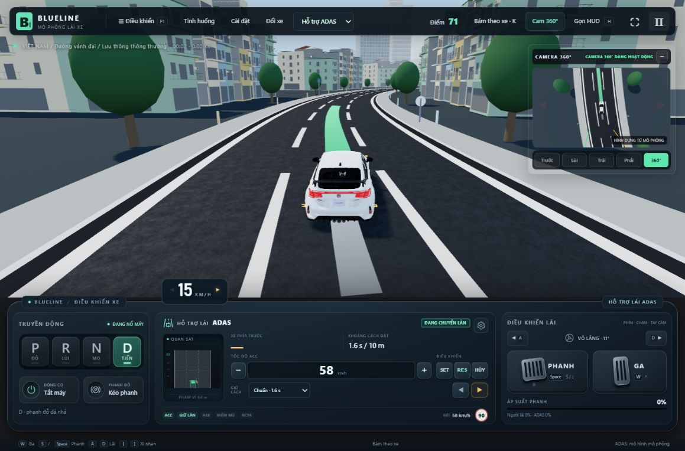
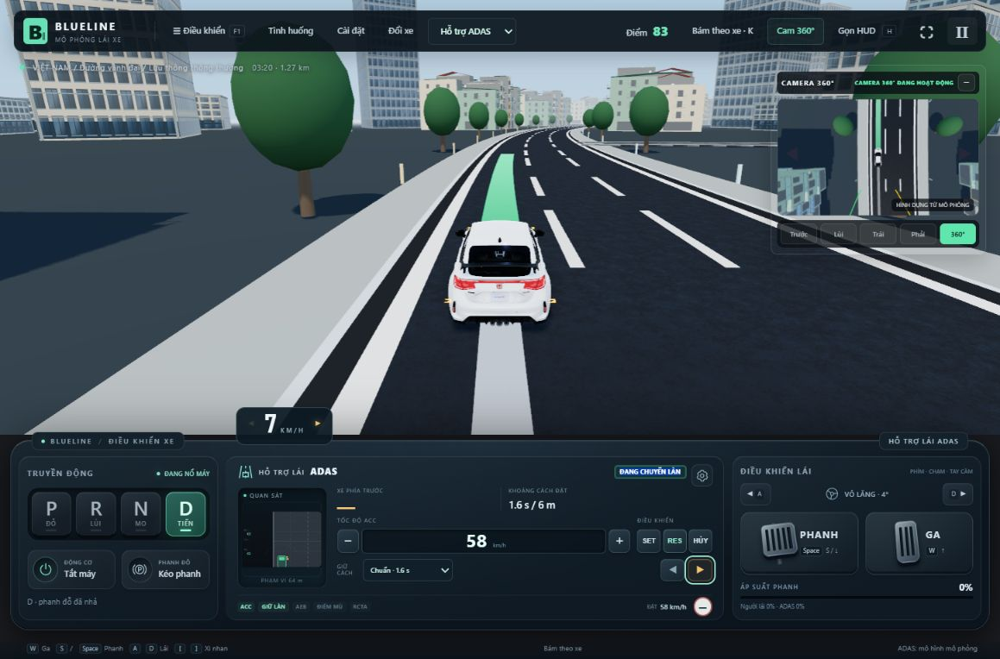

# Sửa xi-nhan bấm lặp khi ALC đang chuyển làn

Ngày: 29/10/2026.

## Lỗi và nguyên nhân

Lần nhấn cùng chiều thứ hai đổi xi-nhan về 0. ALC coi đó là hủy quỹ đạo, nhưng LFA vẫn giữ mục tiêu là tâm làn trước lúc chuyển. Xe vì thế có thể bị kéo trở lại làn cũ. Bộ cảnh báo còn gộp trạng thái chạm giới hạn độ bám ngang với nguy cơ tốc độ quá cao theo độ cong đường, nên có thể gắn nhãn “cua gắt” cho tác động lái đổi hướng đột ngột trên đoạn đường thẳng.

Đã tái hiện bằng [bài kiểm thử trước sửa](ALC_REPEAT_REPRO_2026-10-29.log), không suy từ việc biên dịch thành lỗi đã hết.

## Hành vi sau sửa

- Khi ALC **đã bắt đầu**, bấm lặp xi-nhan cùng chiều không hủy hoặc khởi động lại quỹ đạo. Bấm sang chiều đối diện trong lượt này cũng không làm xe đảo hướng hoặc xếp thêm một lượt chuyển làn tự động. Xe giữ xi-nhan của lượt hiện tại, hoàn tất rồi tự tắt.
- Khi ALC mới chờ kiểm tra/chưa bắt đầu hoặc đang lái thủ công, nhấn lần hai vẫn tắt xi-nhan như trước.
- Phanh, đánh lái hoặc mất điều kiện an toàn vẫn hủy ALC. Nếu LFA còn hoạt động, mục tiêu ổn định được cập nhật theo làn xe đang chiếm giữ, không kéo về tâm làn đã lưu trước đó. Người lái đánh lái vẫn có quyền tiếp quản; mất vạch/camera không bị ép giữ lái.
- Cảnh báo phân biệt **tốc độ quá cao theo độ cong đường** và **chạm giới hạn độ bám ngang**. Không tắt các cảnh báo giới hạn thật. Trên đoạn thẳng, chạm giới hạn lốp không được tự gọi là cua gắt.
- Áp dụng chung cho nút trên bảng điều khiển, bàn phím `[`/`]` và cần gạt tay cầm qua cùng `Simulation.toggleIndicator`. Nút trên bảng có hướng dẫn lúc ALC hoạt động: “bấm lặp không đổi hướng; đạp phanh hoặc đánh lái để tiếp quản”.

Đây là quy tắc điều khiển của cấu hình BlueLine, không phải xác nhận hoạt động của một ECU thương mại cụ thể.

## Kiểm chứng

- `scripts/alc-indicator-repeat-test.ts` chạy **96 cặp**: một xe không bấm lặp và một xe bấm lặp. Hai hướng trái/phải, bốn thời điểm trong quá trình, ba vận tốc ban đầu 5/50/90 km/h, đường cao tốc/vành đai, khô/ướt. Tọa độ và góc bánh xe phải giống nhau giữa hai lượt sau khi bấm lặp; đến đúng làn đích, xi-nhan tự tắt, không va chạm/ra khỏi đường và không phát sinh cảnh báo giới hạn mới do lần bấm lặp.
- Kiểm tra riêng: phanh/đánh lái vẫn hủy, xi-nhan thường vẫn tắt bằng lần nhấn thứ hai, phanh sau khi đã qua vạch không kéo xe trở lại làn cũ, phân loại cảnh báo độ bám trên đoạn thẳng và cảnh báo cua thật.
- Bài thử phân loại độ bám ban đầu thiếu bật giới hạn bám đường trong giàn thử `Vehicle`, nên đợt hồi quy đầu có một lỗi fixture. Đã sửa giàn thử để thực sự tạo trạng thái bão hòa độ bám; không đổi điều kiện kiểm tra để chấp nhận nhầm cảnh báo. [Bài kiểm thử mới chạy lại đạt](ALC_REPEAT_FINAL_2026-10-29.log), 32,6 s. Các lỗi cũ và log đợt đầu được giữ lại.
- Sau khi sửa fixture, chạy xác nhận lại toàn bộ nhóm liên quan: **16/16 nhóm đạt, 157,3 s** — [log xác nhận cuối](ALC_REPEAT_VERIFIED_2026-10-29.log). Gồm ALC mọi tốc độ, bấm lặp, quyền tiếp quản, giữ làn tốc độ cao, cua/độ bám, bàn phím, phanh AEB/ACC, replay và EDSS/làn khẩn cấp.
- Trình duyệt: trên đường vành đai, khi bảng hiển thị “ĐANG CHUYỂN LÀN”, bấm thêm hai lần nút xi-nhan phải; trạng thái vẫn đang chuyển làn và xi-nhan phải vẫn bật. Đã thử thêm hai lần phím `]` bằng sự kiện bàn phím của trang khi ALC đang chạy, kết quả tương tự. Sau hoàn tất, kiểm tra xe ổn định trong làn và xi-nhan tự tắt.
- [Build đạt](ALC_REPEAT_BUILD_2026-10-29.log). Cảnh báo kích thước gói Three.js vẫn còn.

## Phạm vi

Sửa lỗi vòng đời lệnh xi-nhan, mục tiêu giữ làn khi hủy và nội dung cảnh báo. Không bảo đảm chuyển làn an toàn trong mọi tình huống hoặc vượt giới hạn độ bám/động lực của xe. Quỹ đạo vẫn phải hủy khi kiểm tra an toàn phát hiện nguy hiểm; khi đó cần thao tác yêu cầu mới sau khi điều kiện được khôi phục.
